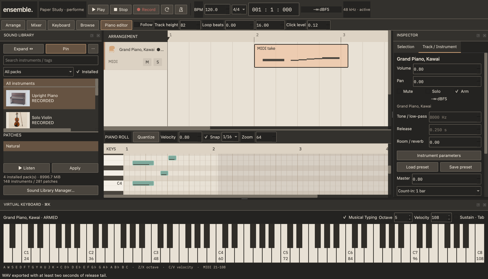

# Reverie Ensemble 0.4.0

QuadraJ's free, open-source native DAW: C++20, Qt 6 Widgets, miniaudio and the independent Reverie Audio Core. Original code remains Apache-2.0. Third-party engines, fonts, illustrations and sounds retain their own licenses.

0.4 connects **finding an instrument → playing it → recording MIDI → editing → saving → WAV export**. The Paper & Graphite workspace, existing audio recorder, Mixer, Settings and project sound remain intact.



## Build on macOS

Apple Silicon was tested. Xcode/Command Line Tools, CMake, shared Qt 6.4+ and libsndfile are required. Bootstrap explicitly downloads pinned synthesis dependencies; normal application builds do not download sounds or source.

```sh
brew install cmake ninja qtbase qtsvg libsndfile
sh scripts/bootstrap_instruments.sh
cmake -S . -B build-04-release -G Ninja -DCMAKE_BUILD_TYPE=Release
cmake --build build-04-release -j 4
ctest --test-dir build-04-release --output-on-failure
open build-04-release/ReverieEnsemble.app
```

Use a fresh build directory after bootstrap. The default FluidSynth configuration uses our source build with Readline and unused device integrations disabled. System FluidSynth is an explicit opt-in; inspect its transitive licenses first. `-DREVERIE_EXTERNAL_INSTRUMENTS=OFF` keeps the legacy core available without external engines. Qt SVG is optional with raster icon fallback.

The development app links installed shared dependencies. It is **not a signed/notarized standalone release**. See [licenses and distribution](THIRD_PARTY_LICENSES.md) and the [complete implementation/verification report](docs/ENSEMBLE_0.4_REPORT.md).

## Find, play and record

1. Use Sound Browser search/categories/pack filter, choose an instrument and its Patch, then **Listen**, **Apply**, double-click or drag onto a MIDI track. **Expand / Cmd+Shift+B** opens the resizable three-column browser. Pin keeps it open. Images and small SVG icons are assets, not enlarged procedural drawings.
2. Open **Keyboard / Cmd+K**. Mouse press holds a note until release. Enable Musical Typing: **A W S E D F T G Y H U J K** plays chromatic C–C; **Z/X** changes octave, **C/V** velocity, **Tab** sustain. Chords work. Text fields do not play notes. The selected MIDI track supplies the actual sound.
3. **Arm** the track in Inspector or its context menu, choose count-in none/1/2 bars, then **Record**. Stop inserts an editable MIDI clip with note length/velocity/channel and controllers. Audio recording requires an armed Audio track; it no longer silently creates one for a MIDI take. Recording is one armed track and linear, without loop overdub.
4. Double-click the clip to edit. Draw/drag/resize notes, Quantize, or use native right-click actions. Right-click no longer deletes a note. Delete/Backspace still deletes selection. Arrangement context menus support real duplication, splitting, mute, copy/paste and track commands with Undo/Redo.
5. Save the version-4 project and media folder together. Versions 1–3 remain readable; old patches are not automatically recalibrated. WAV export uses the same core and offers PCM16/24/float32, 44.1/48/96 kHz, mono/stereo, ranges, tails, optional normalization/dither and cancel.

## Sound libraries and formats

The existing bundled library remains **13 recorded instruments / 14 patches / 85 WAVs (~95 MiB)**, plus eight synth presets and synthetic drums.

Sound Library Manager offers two full optional CC0 packs using original SFZ mappings and verified payloads:

| Collection | Instrument entries | Patches | Audio files | Payload |
|---|---:|---:|---:|---:|
| VSCO 2 CE | 24 | 75 | 3,168 | 3.18 GB |
| VCSL | 102 | 183 | 4,256 | 6.16 GB |

**258/258 original patches were rendered successfully.** Instrument entries across collections can overlap; file counts are not represented as instrument counts. Full samples are optional downloads, not committed multi-gigabyte binaries. The native manager supports explicit download consent, progress/cancel, file SHA-256/size verification, atomic install/update, remove/reinstall and immediate search refresh. Active-project packs are protected. ZIP extraction and partial-download resume are not exposed.

SFZ uses **sfizz 1.2.3** for new full packs and imports. Old projects retain the built-in sampler. **FluidSynth 2.6.1** loads actual **SF2/SF3** banks/programs through **⋯ → Import SFZ / SoundFont**. No third-party GM SoundFont is bundled. Advanced user SFZs can play through sfizz; complex macro paths remain external references when safe collection is unavailable. [Format scope](docs/SOUND_FORMATS.md).

External MIDI uses macOS CoreMIDI with source/channel selection, note/velocity, sustain, modulation, pitch bend and safe disconnection handling. **Physical MIDI hardware and pedals were not available for verification.** Mock input, real native keyboard events, recorded MIDI and actual device audio were tested separately from listening quality.

## Evidence and examples

- Debug **8/8**, Release **8/8**, core ASan+UBSan **4/4**.
- Native Cocoa/miniaudio full sfizz Grand Piano Musical Typing → nine MIDI notes with sustain/count-in → collect/save/reopen → WAV.
- Actual HTTPS instrument installation/render, update, corrupt-hash rollback, cancellation cleanup, removal and reinstall.
- First Light v1 and legacy v2 WAVs remain byte-identical to the previous executable.
- [Actual screenshots and detailed results](docs/TESTING.md), [full 0.4 report](docs/ENSEMBLE_0.4_REPORT.md), [library inventories and calibration](docs/measurements/0.4/library-summary.json).
- [Typing Study project](examples/Typing%20Study.reverie) and [WAV](examples/Typing%20Study.wav) are from the automated UI recording workflow, using the bundled sample bytes. The larger native full-library recording is generated under `out/native-performance04/` by the explicit native probe.

Run the full library reproduction only when you want the ~9.33 GB download:

```sh
python3 scripts/build_community_catalog.py --download
python3 scripts/enrich_community_catalog.py
build-04-release/reverie-library-audit out/community04/vsco out/vsco.csv --verify
build-04-release/reverie-library-audit out/community04/vcsl out/vcsl.csv --verify
```

No human musician listening assessment, long-session/hardware latency certification, Intel/non-macOS UI certification or clean-machine LGPL replacement test is claimed. GarageBand still leads in device ergonomics, loop takes, content curation and instrument-specific controls. [0.5 priorities](docs/ROADMAP.md). [0.3 documentation archive](docs/archive/README-0.3.md).
