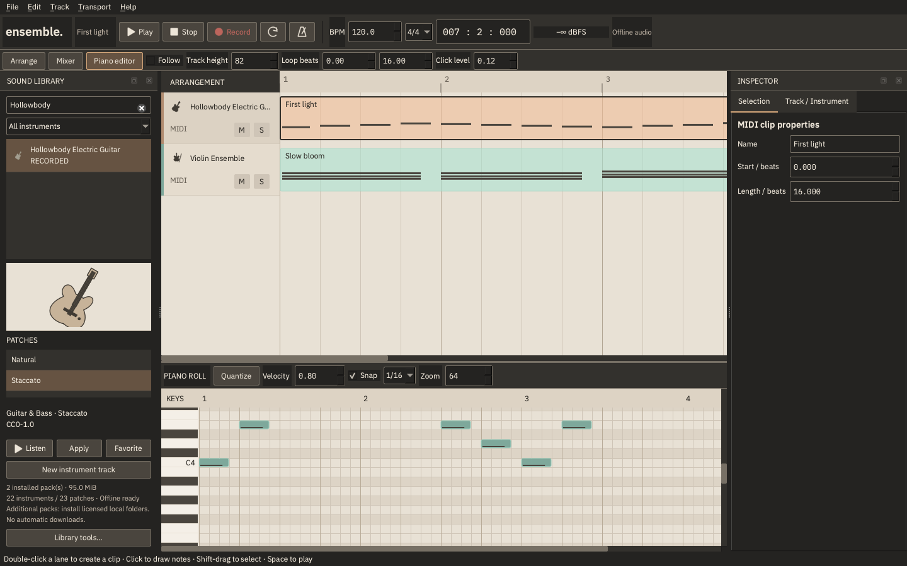

# Reverie Ensemble 0.3.0

QuadraJ's free, open-source native DAW: C++20, Qt 6 Widgets, miniaudio and the independent Reverie Audio Core. Core editing, installed instruments, project saving and WAV export work offline without accounts.

0.3 improves **sound balance, instrument discovery, precise navigation and audio export**. The Paper & Graphite workspace and IBM Plex Sans KR/Mono typography remain. Original code is Apache-2.0; Qt, fonts and audio retain their separate licenses.



## Build and run on macOS

Requires Xcode/Command Line Tools, CMake, Ninja and shared Qt 6.4+. Tested on Apple Silicon; Intel, Windows and Linux remain unverified.

```sh
xcode-select --install # only if Command Line Tools are missing
brew install cmake ninja qtbase
cmake -S . -B build-03-release -G Ninja -DCMAKE_BUILD_TYPE=Release \
  -DCMAKE_PREFIX_PATH="$(brew --prefix qtbase)"
cmake --build build-03-release -j 4
ctest --test-dir build-03-release --output-on-failure
open build-03-release/ReverieEnsemble.app
```

The repository includes the fonts and two compact recorded packs. No runtime or build-time sound downloads occur. The macOS bundle receives its own `Resources/assets`; it does not depend on sibling projects. The development app uses installed Qt shared frameworks and is **not** a signed/notarized standalone distribution.

Qt-free, hardware-free core tests:

```sh
cmake -S . -B build-core -G Ninja -DREVERIE_BUILD_GUI=OFF
cmake --build build-core -j 4
ctest --test-dir build-core --output-on-failure
```

## Create music

1. **File > New** starts empty. Browse/search by instrument, category, tags or patch. Choose an instrument, then its Patch. **Listen** plays actual audio; **Apply/double-click** assigns it to the selected MIDI track; **New instrument track** or dragging onto empty arrangement space adds a track. Favorites/recent items are local.
2. Double-click a MIDI lane to create a clip; double-click the clip to edit. Click to draw notes; drag bodies to move and right edges to resize. Cmd/Ctrl-click selects multiple notes, Shift-drag selects a region, right-click/Delete removes notes. Cmd/Ctrl+D duplicates focused piano-roll notes; Quantize/Q and velocity edits support Undo/Redo. Keys and note entry/movement audition the actual instrument across MIDI 0-127.
3. Move/duplicate/trim clips, rename/color/reorder tracks and use real Mute/Solo/Volume/Pan. Adjust Snap, Zoom, track height and Follow. Track headers and piano keys stay fixed horizontally.
4. Drag the ruler/playhead to seek. Option/Alt temporarily disables Snap. Shift-drag creates a cycle range; drag the upper range handles to adjust it. Enter `2:1:000` in Transport for bars/beats/ticks, or `0:12.5s` for elapsed time; press Return. Right-click the display to switch musical/time display. Ticks are **960 per notated beat**. Audio scrubbing is not implemented.
5. Loop and signature-aware Metronome are real transport tools. They and private instrument audition are excluded from offline export. Follow pauses automatic scrolling during mouse editing.
6. **Mixer** provides dB faders/direct entry, stereo meters, pan, mute/solo/master and working two-band tone EQ, delay and reverb. Inspector follows clip/note selection. Track/Instrument controls expose actual tone/envelope/reverb parameters; unsupported amp/cabinet/pedal controls are absent.
7. **Save** writes version-3 `.reverie` plus a collected `<name>.media` folder. Keep them together. All multisample WAVs, calibration, mapping, mixer/effects and loop settings are preserved. Versions 1 and 2 remain readable; old mixes are **not** recalibrated automatically. Selecting a new factory patch explicitly adopts calibration v1.
8. **File > Export Audio...** opens one dedicated dialog: WAV PCM16/24 or float32, 44.1/48/96 kHz, mono/stereo, entire project/cycle/selected clip range, optional release/effect tail, explicit -1 dBFS peak normalization and integer TPDF dither. Rendering runs on a worker with progress/cancel; a successful render atomically replaces the destination. Over-range output is reported. Float WAV preserves headroom; PCM saturates safely. RIFF size is limited to 4 GiB. MP3/AAC/AIFF/FLAC are not offered.
9. **Ensemble > Settings... (Cmd+,)** on macOS controls input/output devices, requested sample rate/buffer, refresh and a quiet test tone. Requested client settings and backend-reported format/period are separate. Nominal queued duration is **not** measured physical round-trip latency. Recording must stop before device changes. Library, Interface and General tabs expose actual functionality and persistence policies.

## Recorded instruments and sound quality

Two bundled packs contain **85 original WAV recordings, 13 recorded instruments / 14 recorded patches**, approximately 95 MiB. The original eight synth presets and synthetic drums remain separate.

| Pack / instrument | Selection |
|---|---|
| Community Essentials 1.1 | Upright Piano, Solo Violin, Violin Ensemble, Cello Ensemble, Pizzicato Contrabass, Concert Flute, Concert Trumpet, Marimba, Recorded Percussion; 35 unchanged VSCO 2 CE recordings |
| Concert Grand Piano | VCSL Kawai, 3 root keys x 2 actual velocity layers; original SFZ gain/offset corrections |
| Electric Bass | Karoryfer Fashionbass, 3 roots x 2 layers x 2 round-robins |
| Hollowbody Electric Guitar | Karoryfer Black guitar: Natural 4 roots x 2 layers x 2 round-robins; Staccato patch uses 4 distinct recordings |
| Acoustic Drum Kit | VCSL kick/snare/closed & open hats/high & low tom, GM 36/38/42/46/48/45, 2 round-robins each |

Ensemble Essentials 1.0 supplies the four new instruments using 50 selected WAVs, about 39 MiB. This is a compact selection, not a fully sampled commercial library. Electric Piano and Acoustic Guitar are still missing. One Natural/Staccato guitar instrument is counted once, rather than inflating instrument counts.

Factory calibration measures low/middle/high notes at velocity 0.3/0.7/1.0, with strong-note peak headroom. Representative median-RMS spread across 23 patches/presets decreased from **36.65 to 14.70 dB**. Transient/sustain differences are retained; there is no hidden compressor/limiter. Audition gain is separate from the stored mix. [Actual measurements and policy](docs/INSTRUMENT_CALIBRATION.md).

Instrument silhouettes and detailed artwork are original, code-rendered QuadraJ vector illustrations. They are separate assets from the CC0 audio; no Apple imagery or samples are used.

## User libraries, MIDI files and recording

- Import the documented **SFZ subset**, not arbitrary SFZ extensions. Key/velocity zones, root key, sample bounds, loop modes, gain, preset envelope and seq_length/seq_position round-robin are supported. New library selections use cubic interpolation; legacy projects retain linear interpolation. Pedal, release triggers, crossfaded loops, band-limited resampling and disk streaming remain unfinished.
- **Library tools > Install local sound pack** verifies an unpacked folder's `pack.json`, paths, symlink boundaries, file sizes/SHA-256 and mapping references before staged installation. It does not unpack ZIP or download automatically. Explicit collection links open official external pages only. [Formats and pack release workflow](docs/SOUND_FORMATS.md).
- Existing WAV import, cached waveforms, non-destructive source offset, single-WAV sampler, preset save/load and worker-based audio recording remain. Select an audio track, save the project, choose input in Settings, then Record; Stop places the take. macOS microphone permission is requested on capture. Physical microphone/permission/hotplug tests were **not** performed this session.
- File > Import MIDI supports SMF 0/1 PPQ, running status, velocity/duration and the first tempo/signature. External MIDI device input, controller/pedal playback/recording and tempo automation are not implemented.
- SF2/SF3/FluidSynth remain **not integrated**. No placeholder SoundFont/Bank/Program controls are shown.

## Demo and tools

Open [Demo Composition](examples/Demo%20Composition.reverie): Piano, Bass, Guitar, Acoustic Drums, Pad and Audio. Its relative references require the repository assets; Save collects them for portability. The Audio track is a **rendered guitar bounce**, not a microphone recording.

```sh
build-03-release/reverie-demo03 assets/sounds out/demo03
build-03-release/reverie-demo03 --reopen 'out/demo03/Demo Composition.reverie' out/reopened.wav
cmp 'out/demo03/Demo Composition.wav' out/reopened.wav
build-03-release/reverie-calibrate assets/sounds out/levels.csv
build-03-release/reverie-render 'examples/First Light.reverie' out/legacy.wav
```

The legacy `reverie-render` defaults to 48 kHz / PCM16 stereo for compatibility. The new GUI Export dialog and `renderAudio` API expose the larger format matrix.

## Limits and evidence

32 voices/track, 64 tracks, 512 MiB live sample-cache budget; history/active graphs can retain additional ownership. Sparse pitch/velocity coverage, hard-switched layers, no advanced SFZ, streaming, sustain pedal, external MIDI, count-in, monitoring/latency compensation, automation, compressor, clip split/fades or automatic drummer. Initial EQ/reverb are simple DSP, not mastering effects. Physical device hotplug/long-session latency, Intel/universal, other platforms, accessibility and signed/notarized standalone packages need further validation.

[GarageBand benchmark](docs/GARAGEBAND_BENCHMARK.md) openly records these gaps; Ensemble does not claim GarageBand parity. [Build/test/screenshots](docs/TESTING.md) distinguish automated checks from unperformed listening/hardware tests.

[Architecture](docs/ARCHITECTURE.md) | [Design](docs/DESIGN_SYSTEM.md) | [Project format](docs/PROJECT_FORMAT.md) | [Sound provenance](docs/SOUND_LIBRARY_LICENSE_MANIFEST.md) | [Third-party licenses](THIRD_PARTY_LICENSES.md) | [Distribution/relinking](docs/DISTRIBUTION.md) | [0.4 priorities](docs/ROADMAP.md) | [Contributing](CONTRIBUTING.md)
