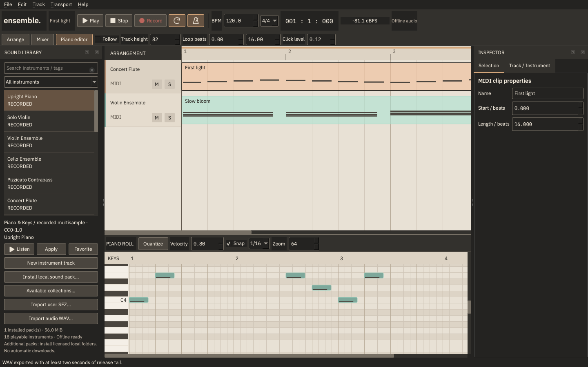

# Reverie Ensemble 0.2.0

QuadraJ의 무료 오픈소스 네이티브 DAW. C++20, Qt 6 Widgets, miniaudio와 독립적인 **Reverie Audio Core**를 사용합니다. 계정·클라우드·런타임 인터넷 연결 없이 작곡, 녹음, 믹싱, 프로젝트 저장 및 WAV 출력을 제공합니다.

0.2는 **Paper & Graphite** 작업 공간, IBM Plex 타이포그래피, 실제 녹음 기반 악기 라이브러리와 작곡 중 미리 듣기를 추가합니다. 자체 코드는 Apache-2.0이며 Qt·폰트·샘플 등 제삼자 구성 요소의 라이선스는 각각 유지됩니다.



## macOS에서 빌드하고 실행하기

Xcode 또는 Command Line Tools, CMake, Ninja, 동적 링크 Qt 6.4 이상이 필요합니다. 검증 환경은 Apple Silicon macOS이며 Intel/Windows/Linux는 아직 실행 검증하지 않았습니다.

```sh
xcode-select --install # Xcode/Command Line Tools가 없을 때만
brew install cmake ninja qtbase
cmake -S . -B build-02-release -G Ninja \
  -DCMAKE_BUILD_TYPE=Release \
  -DCMAKE_PREFIX_PATH="$(brew --prefix qtbase)"
cmake --build build-02-release -j 4
ctest --test-dir build-02-release --output-on-failure
open build-02-release/ReverieEnsemble.app
```

기본 악기팩과 OFL 폰트는 저장소에 포함됩니다. 별도 수 GB 다운로드나 선택적 악기 엔진 없이 기본 앱을 빌드·사용할 수 있습니다. CMake와 앱은 사운드를 자동 다운로드하지 않습니다. macOS `.app`에 독립적인 `Resources/assets`를 복사하며 개발자 상위 프로젝트의 폰트 경로에 런타임 의존하지 않습니다. 개발용 앱은 설치된 Qt 동적 라이브러리를 사용합니다. 독립 배포 패키지·서명·공증은 별도 검증이 필요합니다.

Qt나 오디오 하드웨어 없는 코어 빌드:

```sh
cmake -S . -B build-core -G Ninja -DREVERIE_BUILD_GUI=OFF
cmake --build build-core -j 4
ctest --test-dir build-core --output-on-failure
```

오프라인 도구:

```sh
build-02-release/reverie-render song.reverie song.wav
build-02-release/reverie-render --demo demo.wav
build-02-release/ReverieEnsemble.app/Contents/MacOS/ReverieEnsemble --no-audio
```

## 음악 만들기

1. 앱은 실녹음 Upright Piano와 Violin Ensemble을 적용한 두 트랙의 데모로 시작합니다. 기본 팩이 없으면 기존 합성 악기로 안전하게 시작합니다. **File → New**는 빈 프로젝트입니다.
2. Sound Library에서 이름·카테고리·태그로 악기를 검색합니다. **Listen**은 실제 음색을 미리 듣고, **Apply / 더블클릭**은 선택한 MIDI 트랙에 적용합니다. **New instrument track** 또는 타임라인 빈 영역으로 드래그하면 새 트랙을 만듭니다. Favorites는 로컬에 저장됩니다.
3. 빈 MIDI 트랙 영역을 더블클릭해 클립을 만들고, 클립을 더블클릭해 Piano Roll을 엽니다. 그리드를 클릭해 노트를 추가합니다. 왼쪽 건반, 노트 입력·선택·음높이 이동 시 실제 악기를 미리 듣습니다. 전체 MIDI 0–127 범위를 스크롤할 수 있습니다.
4. 노트 몸체를 드래그해 위치·높이를, 오른쪽 끝을 드래그해 길이를 바꿉니다. Cmd/Ctrl 클릭은 복수 선택, Shift 드래그는 영역 선택, 우클릭/Delete는 삭제입니다. 피아노 롤에 포커스가 있으면 Cmd/Ctrl+D로 노트를 복제합니다. **Quantize / Q**와 Velocity 편집은 실제 MIDI 모델과 Undo/Redo에 연결됩니다.
5. 클립 이동·복제·오른쪽 Trim, 트랙 이름·색상·Mute/Solo·순서 변경을 지원합니다. 수평 스크롤 시 트랙 헤더가 고정됩니다. **Track height**, **Zoom**, **Snap**, **Follow**로 편집 환경을 조절합니다. 하단 편집기와 Inspector를 접거나 숨길 수 있습니다.
6. Transport의 Loop와 Metronome 버튼을 사용합니다. 편집 도구 행에서 루프 시작/끝을 **0 기준 quarter-note beats**로 설정합니다. 클릭은 박자표의 분모에 맞춰 동기화되고 첫 박을 강조합니다. Click level로 음량을 조절합니다. 메트로놈과 라이브 미리 듣기는 WAV export에 포함되지 않습니다.
7. **Mixer** 모드에서 실제 채널별 stereo peak meter, dB 페이더·숫자 입력, Pan, Mute/Solo, Master를 사용합니다. **EQ / Space**를 켜면 실제 두 대역 EQ, Delay, Reverb가 처리됩니다. 필드는 작동하는 이펙트만 표시합니다.
8. Inspector의 **Selection**은 클립·노트의 위치·길이·velocity·음높이 또는 오디오 소스 offset을 편집합니다. **Track / Instrument**는 선택 트랙과 악기 설정을 다룹니다. 고급 ADSR·필터는 접을 수 있습니다. 오디오 클립 선택 시 하단에는 캐시 기반 Waveform Editor가 표시됩니다.
9. **File → Save**는 version 2 `.reverie`와 옆의 `<프로젝트명>.media/`에 모든 참조 WAV를 수집합니다. 멀티샘플 매핑과 출처·라이선스도 보존합니다. 저장 성공 후 현재/Undo/Redo의 경로를 수집 폴더로 갱신합니다. 프로젝트 파일과 미디어 폴더를 함께 옮기면 됩니다.
10. **File → Export WAV**는 같은 DSP로 48 kHz stereo PCM16을 출력합니다. 노트 release와 효과 tail을 포함합니다. 0.1 프로젝트와 `examples/First Light.reverie`도 계속 열립니다. 저장 시 v2로 마이그레이션합니다.

## 기본 라이브러리

Community Essentials는 VSCO 2 CE의 CC0 원본 WAV 35개에서 구성한 약 56 MiB의 작은 팩입니다. 하나의 WAV를 이름만 바꿔 여러 악기로 중복 등록하지 않았습니다.

| 악기 | 원본 녹음 | 매핑 |
|---|---|---|
| Upright Piano | Upright Nr. 1 | 4 pitch zones |
| Solo Violin | Solo Violin Arco Vibrato | 4 pitch zones |
| Violin Ensemble | Violin Section Sustain Vibrato | 4 pitch zones |
| Cello Ensemble | Cello Section Sustain Vibrato | 4 pitch zones |
| Pizzicato Contrabass | Solo Contrabass Pizzicato | 4 pitch zones |
| Concert Flute | Flute Expressive Vibrato | 4 pitch zones |
| Concert Trumpet | Trumpet Sustain | 4 pitch zones |
| Marimba | Outrigger Marimba hits | 4 pitch zones |
| Recorded Percussion Kit | Bass drum, snare, suspended cymbal | GM 36 / 38 / 42 one-shots |

이는 작은 **선별 멀티샘플 팩**이며 전체 VSCO 2 CE나 완전한 드럼 키트가 아닙니다. 일부 원음의 옥타브 이름은 서로 달라 공식 SFZ의 `pitch_keycenter`를 대조해 교정했습니다. 극단적인 음역에서는 적은 샘플을 피치 이동하므로 정교한 상용 멀티샘플 악기 수준이라고 주장하지 않습니다. 기본 팩의 velocity는 음량에 반영되며 여러 실제 velocity 녹음 레이어는 아직 포함하지 않았습니다. 엔진의 velocity-zone 기능은 별도 DSP fixture로 검증합니다. 기존 합성 프리셋 8종과 합성 드럼도 유지합니다.

[출처·라이선스 manifest](docs/SOUND_LIBRARY_LICENSE_MANIFEST.md), [샘플별 SHA-256 및 원본 파일](assets/sounds/factory/pack.json).

## 사용자 악기, 사운드팩, 녹음 및 MIDI

- **Import user SFZ…**는 지원하는 기본 SFZ 매핑을 읽습니다. 키·velocity zone, root key, offset/end, loop points, one-shot/sustain, gain과 preset envelope를 지원합니다. 임의의 SFZ 전체와 호환된다는 의미는 아닙니다. 지원 명령과 제한은 [사운드 시스템](docs/SOUND_FORMATS.md)을 참고하세요.
- **Install local sound pack…**은 `pack.json`이 있는 **이미 압축 해제된 폴더**를 설치합니다. 설치 전에 표시된 용량·출처·라이선스를 확인합니다. 상대 경로·symlink 경계·SHA-256·파일 크기·매핑 참조를 검증한 뒤 임시 폴더에서 원자적으로 설치합니다. ZIP을 직접 풀거나 자동 다운로드하지 않습니다. **Available collections…**는 외부 공식 페이지를 사용자가 요청했을 때 엽니다. 외부 전체 컬렉션을 설치된 악기처럼 표시하지 않습니다.
- 0.1의 WAV 가져오기·단일 WAV 샘플러·프리셋 저장/불러오기와 녹음 기능도 유지합니다. 오디오 트랙을 선택하고 프로젝트를 저장한 뒤 입력을 골라 Record를 누릅니다. macOS 마이크 권한은 녹음 시 요청합니다. 디스크 쓰기는 녹음 작업 스레드가 담당하고 종료된 take를 타임라인에 넣습니다. 녹음 중에는 편집·미리 듣기를 잠급니다.
- **File → Import MIDI file…**은 SMF type 0/1, PPQ, running status, note velocity/length, 첫 템포·박자표를 가져옵니다. 채널별로 트랙을 나누고 GM percussion channel은 합성 드럼으로 연결합니다. 빈 프로젝트에서만 파일 템포를 채택합니다. 템포 자동화/SMPTE/프로그램·CC 연주는 지원하지 않습니다.

## 현재 제한

- SF2/SF3 및 FluidSynth는 **통합하지 않았습니다**. 지원하지 않는 메뉴나 Bank/Program 선택 UI도 노출하지 않습니다. 실시간 호출 안전성을 검증한 백엔드가 후속 작업입니다.
- 외부 MIDI 키보드 입력, count-in, 입력 monitoring, 녹음 지연·장치 clock drift 보정은 아직 없습니다. 실제 마이크 allow/deny, hotplug, 긴 세션과 물리적 지연 검증도 별도 수동 항목입니다.
- 코어는 44.1/48 kHz를 포함한 구조를 유지하지만 GUI 장치 설정은 48 kHz / 256-frame **목표**입니다. 실제 하드웨어 협상 크기/지연과 동일하다는 뜻은 아닙니다.
- 신스·멀티샘플러는 트랙당 32보이스, 최대 64트랙입니다. 샘플당 20분/256 MiB decoded PCM, 캐시/프로젝트 로더는 512 MiB 예산을 사용합니다. Undo/history가 보유한 메모리와 큰 프로젝트의 전체 메모리 정책은 계속 개선해야 합니다.
- 샘플 리샘플링은 선형 보간이며 loop는 단방향입니다. SFZ round-robin, release-trigger, sustain-pedal, streaming, per-region envelope/filter는 없습니다. 일반 노트 seek는 envelope를 다시 시작하며 elapsed sample phase를 복원하지 않습니다.
- Loop 경계는 짧은 fade와 DSP reset을 사용합니다. 모든 소스/장치/효과 설정에서 무글리치를 보증하지 않습니다. 일반 master/transport/오디오 clip edge의 완전한 smoothing은 후속 작업입니다. 매우 높은 feedback/delay는 export tail을 길게 만듭니다.
- 초기 EQ는 고정 800 Hz 분리의 두 대역 tone control, reverb는 간단한 comb network입니다. 전문 mastering EQ/reverb나 플러그인 호스트가 아닙니다. 최종 출력은 hard clip하며 true-peak limiter/dither는 없습니다.
- 독립 배포 패키지, 서명·공증, Intel/universal, Windows/Linux는 검증하지 않았습니다.

## 문서

[디자인 시스템](docs/DESIGN_SYSTEM.md) · [엔진 구조](docs/ARCHITECTURE.md) · [포맷과 마이그레이션](docs/PROJECT_FORMAT.md) · [테스트 기록](docs/TESTING.md) · [0.3 로드맵](docs/ROADMAP.md) · [제삼자 라이선스](THIRD_PARTY_LICENSES.md) · [배포 및 재링크](docs/DISTRIBUTION.md) · [기여](CONTRIBUTING.md)
